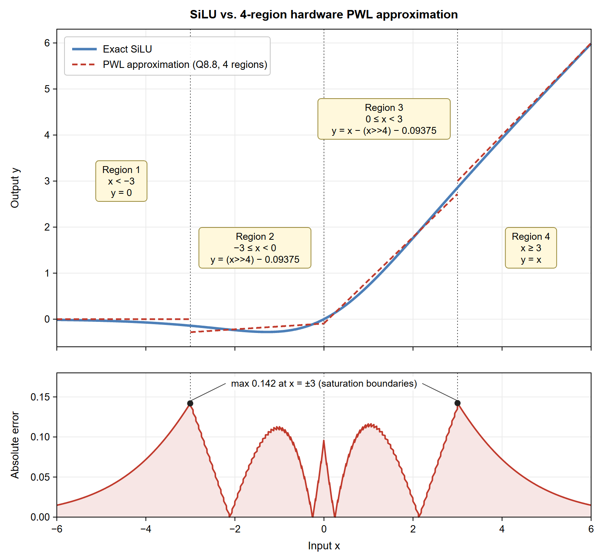

# Shay Dahan

I design processors and hardware accelerators in Verilog, verify them thoroughly in
simulation, and run them on real FPGA boards.

## Featured project: SiLU accelerator in a 16-bit pipelined RISC processor

A hardware unit for SiLU, an activation function used in neural networks, built into the
execute stage of a five-stage pipelined 16-bit RISC processor and demonstrated on an
Intel MAX 10 FPGA (Arrow DECA board).

- **No multipliers:** a four-region piecewise-linear approximation computed with shifts and
  subtractions only. 77 logic elements, no DSP blocks, one cycle per activation, maximum
  error 0.142 over −8 ≤ x ≤ 8 (Q8.8 fixed point).
- **Processor:** MIPS-like five-stage pipeline with forwarding and hazard detection; about
  3,240 logic elements and 82 MHz on average across placement seeds.
- **Verification:** all 65,536 inputs of the SiLU unit checked exhaustively, 3,500 random
  programs compared against a Python instruction-set model, directed tests, no X/Z values.
- **On the board:** 5,000 activations finish 3.71× faster end to end with the new `SILU`
  instruction than in software (1.0 s instead of 3.7 s).
- **In progress:** multiply-accumulate instructions (`MAC`, `MACB`, `MACR`) with a 40-bit
  accumulator.

**Tools:** Verilog · Intel Quartus Prime · ModelSim · Python · Git
